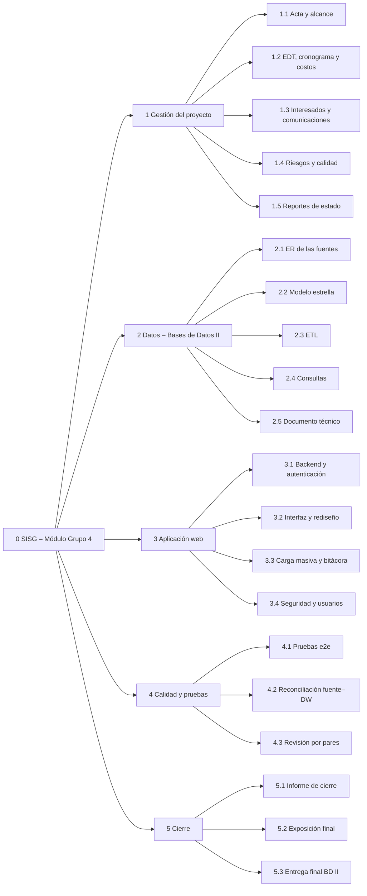
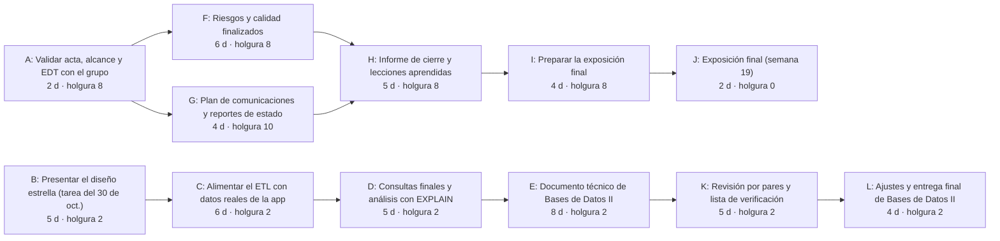
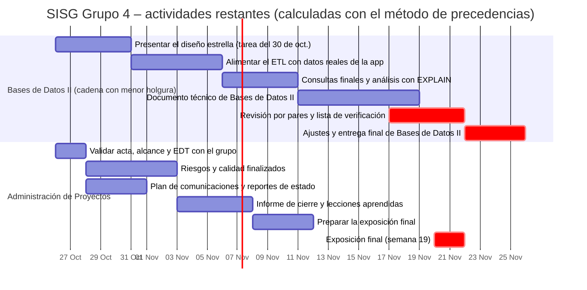

# SISG – Módulo Grupo 4: EDT, cronograma y costos

**Versión:** 0.2 (borrador) · **Corte:** 24 de octubre de 2026 · Se genera con `plan.py`, no se transcribe a mano.
> **Declaración de uso de IA:** ver el apéndice en `05_apendice_declaracion_ia.md`.

## 1. EDT (Estructura de Desglose del Trabajo)
Regla del 100%: los paquetes de trabajo (nivel 2) suman todo el alcance del nivel 1. Las horas son **estimaciones iniciales** del
esfuerzo; el grupo debe reemplazarlas por sus horas reales para que el valor ganado sea válido.

**TABLA I: DICCIONARIO DE PAQUETES DE TRABAJO**

| Código | Paquete | Horas | Fechas | Avance | Responsable |
|---|---|---:|---|---:|---|
| 1.1 | Acta de constitución y alcance | 6 | 24 oct – 26 oct | 50% | Líder |
| 1.2 | EDT, cronograma y costos | 6 | 24 oct – 27 oct | 50% | Líder |
| 1.3 | Interesados y comunicaciones | 5 | 24 oct – 28 oct | 50% | Líder |
| 1.4 | Riesgos y calidad | 6 | 24 oct – 30 oct | 50% | Calidad |
| 1.5 | Reportes de estado semanales | 3 | 1 nov – 20 nov | 0% | Líder |
| 2.1 | ER de las fuentes | 8 | 15 oct – 25 oct | 100% | Datos |
| 2.2 | Modelo estrella | 8 | 24 oct – 30 oct | 80% | Datos |
| 2.3 | ETL | 10 | 24 oct – 10 nov | 70% | Datos |
| 2.4 | Consultas analíticas | 6 | 24 oct – 14 nov | 60% | Datos |
| 2.5 | Documento técnico BD II | 8 | 9 nov – 27 nov | 20% | Datos |
| 3.1 | Backend y autenticación | 25 | 5 oct – 23 oct | 100% | Calidad |
| 3.2 | Interfaz y rediseño | 12 | 24 oct – 24 oct | 100% | Calidad |
| 3.3 | Carga masiva y bitácora | 12 | 24 oct – 24 oct | 100% | Calidad |
| 3.4 | Seguridad y usuarios | 12 | 24 oct – 24 oct | 100% | Calidad |
| 4.1 | Pruebas e2e | 8 | 5 oct – 24 oct | 100% | Calidad |
| 4.2 | Reconciliación fuente–DW | 3 | 24 oct – 24 oct | 100% | Calidad |
| 4.3 | Revisión por pares y verificación | 6 | 9 nov – 20 nov | 0% | Calidad |
| 5.1 | Informe de cierre y lecciones | 8 | 12 nov – 19 nov | 0% | Todos |
| 5.2 | Preparar y dar la exposición final | 10 | 16 nov – 21 nov | 0% | Todos |
| 5.3 | Ajustes y entrega final BD II | 6 | 23 nov – 28 nov | 0% | Datos |

Responsables propuestos por rol (Líder, Datos, Calidad, Todos); el grupo debe asignar personas.

## 2. Secuenciación: método de diagramación por precedencia (PDM)
Actividades **restantes** a partir del lunes 26 de octubre de 2026 (días calendario). Se agregan dos restricciones reales:
la exposición solo puede darse el 20–21 de noviembre (semana 19) y la entrega de Bases de Datos II vence el **28 de noviembre a las 8:00**.
`K(−2)` significa que la revisión por pares empieza 2 días antes de terminar el documento técnico (solape).

**TABLA II: ACTIVIDADES, PREDECESORAS Y HOLGURA (ES/EF = inicio/fin temprano; LS/LF = inicio/fin tardío, en días desde el 26 oct.)**

| ID | Actividad | Duración (d) | Predecesoras | ES | EF | LS | LF | Holgura | Fechas |
|---|---|---:|---|---:|---:|---:|---:|---:|---|
| A | Validar acta, alcance y EDT con el grupo | 2 | — | 0 | 2 | 8 | 10 | 8 | 26 oct – 27 oct |
| B | Presentar el diseño estrella (tarea del 30 de oct.) | 5 | — | 0 | 5 | 2 | 7 | 2 | 26 oct – 30 oct |
| C | Alimentar el ETL con datos reales de la app | 6 | B | 5 | 11 | 7 | 13 | 2 | 31 oct – 5 nov |
| D | Consultas finales y análisis con EXPLAIN | 5 | C | 11 | 16 | 13 | 18 | 2 | 6 nov – 10 nov |
| E | Documento técnico de Bases de Datos II | 8 | D | 16 | 24 | 18 | 26 | 2 | 11 nov – 18 nov |
| F | Riesgos y calidad finalizados | 6 | A | 2 | 8 | 10 | 16 | 8 | 28 oct – 2 nov |
| G | Plan de comunicaciones y reportes de estado | 4 | A | 2 | 6 | 12 | 16 | 10 | 28 oct – 31 oct |
| H | Informe de cierre y lecciones aprendidas | 5 | F,G | 8 | 13 | 16 | 21 | 8 | 3 nov – 7 nov |
| I | Preparar la exposición final | 4 | H | 13 | 17 | 21 | 25 | 8 | 8 nov – 11 nov |
| J | Exposición final (semana 19) | 2 | I | 25 | 27 | 25 | 27 | 0 | 20 nov – 21 nov |
| K | Revisión por pares y lista de verificación | 5 | E(-2) | 22 | 27 | 24 | 29 | 2 | 17 nov – 21 nov |
| L | Ajustes y entrega final de Bases de Datos II | 4 | K | 27 | 31 | 29 | 33 | 2 | 22 nov – 25 nov |

## 3. Ruta crítica (CPM)
- **J (exposición final)** tiene holgura 0 porque su fecha está fija por el calendario del curso.
- La cadena de **Bases de Datos II B → C → D → E → K → L** termina el **25 nov** (fin de día), con **2 días de holgura** frente al límite del 28 de nov. a las 8:00.
  Es la ruta con menor holgura de la entrega de Bases de Datos II; un atraso de más de 2 días en cualquiera de sus actividades la incumple.

### Estimación de tres valores (PERT)
Esperado = (O + 4M + P) / 6 · desviación = (P − O) / 6. Valores O/M/P: **estimaciones del autor del borrador; el grupo debe validarlas**.

**TABLA III: ESTIMACIÓN PERT DE LA CADENA DE BASES DE DATOS II**

| ID | Actividad | O | M | P | Esperado (d) | σ |
|---|---|---:|---:|---:|---:|---:|
| B | Presentar el diseño estrella (tarea del 30 de oct.) | 3 | 5 | 6 | 4.8 | 0.5 |
| C | Alimentar el ETL con datos reales de la app | 4 | 6 | 10 | 6.3 | 1.0 |
| D | Consultas finales y análisis con EXPLAIN | 3 | 5 | 8 | 5.2 | 0.83 |
| E | Documento técnico de Bases de Datos II | 6 | 8 | 12 | 8.3 | 1.0 |
| K | Revisión por pares y lista de verificación | 3 | 5 | 7 | 5.0 | 0.67 |
| L | Ajustes y entrega final de Bases de Datos II | 3 | 4 | 6 | 4.2 | 0.5 |

Duración esperada de la cadena: **31.8 días** (se restan 2 por el solape) con σ = 1.91 días. Días disponibles hasta el límite: **33**.
z = (33 − 31.8) / 1.91 = 0.63 → **probabilidad de cumplir ≈ 74%**.
Para subirla: empezar el ETL con datos reales ya (actividad C), no esperar la presentación de la tarea del 30 de octubre (B), y mantener el solape de K con E.

## 4. Cronograma (Gantt)

El Gantt anterior solo cubre las actividades restantes; el trabajo ya hecho está en la TABLA I (avance 100%).

## 5. Costos y valor ganado
SISG no tiene presupuesto monetario. Se usa **horas-persona** como unidad de costo (el mismo método sirve con quetzales).

- **BAC** (presupuesto total) = **168 h** (suma de la TABLA I).
- **Reserva de contingencia** (13% del BAC, para riesgos identificados) = **21.8 h**. Se subió del 10% sugerido en clase porque las respuestas a los riesgos suman 19 h (ver `04_riesgos_calidad.md`). **Reserva de gestión** (5%, imprevistos) = **8.4 h**. Presupuesto con reservas = 198.2 h.
- Fórmulas: CPI = EV/AC · SPI = EV/PV · EAC = BAC/CPI (si el desempeño de costo continúa) · Avance = EV/BAC.

**TABLA IV: INDICADORES DE VALOR GANADO AL 24 DE OCTUBRE DE 2026**

| Indicador | Valor | Cómo se obtuvo |
|---|---:|---|
| BAC | 168 h | Suma de las horas planificadas |
| PV (valor planificado) | 86.6 h | Horas de cada paquete × fracción del plazo transcurrido |
| EV (valor ganado) | 110.1 h | Horas de cada paquete × % de avance |
| SPI = EV/PV | **1.27** | Mayor que 1: adelantados respecto del plan |
| Avance = EV/BAC | **66%** | |
| AC (costo real) | *pendiente* | **El grupo debe registrar las horas realmente trabajadas** |
| CPI = EV/AC | *pendiente* | Requiere AC |
| EAC = BAC/CPI | *pendiente* | Requiere CPI |

> El SPI > 1 depende de los % de avance y de las horas, que son estimaciones del borrador. No debe reportarse como resultado hasta validar ambos con el grupo.

## 6. Enfoque híbrido: Fase 0 y sprints
Marco **predictivo** (Fase 0 y hitos fin-a-inicio en la ruta crítica) con ejecución **ágil** por sprints, cada uno con su *Sprint Goal*, su incremento y su *Definition of Done* (Scrum Guide 2020 y sesión del 24 de octubre).
La regla del roadmap de la sesión se adapta así: **el modelo de datos verificado va antes que las consultas, y cada sprint construye sobre lo que el anterior dejó verificado**.
Entre sprints hay un hito: si uno se atrasa, se mueve la fecha de los primeros pasos del siguiente (no se solapan sin verificación). El *Product Backlog* son las historias de usuario de `01_acta_y_alcance.md` (Parte B).

**TABLA V: ETAPAS, SPRINT GOAL Y DEFINITION OF DONE**

| Etapa | Sprint Goal / objetivo | Paquetes EDT | Definition of Done (resultado verificable) | Estado al 24 oct. |
|---|---|---|---|---|
| Fase 0 · Preparación (predictiva) | Requisitos, alcance y cronograma de hitos aprobados | 1.1 a 1.4, 2.1 | Acta, alcance y EDT validados por el grupo; ER de las fuentes entregado | ER entregado; documentos en borrador por validar |
| Sprint 1 · Fuente operativa | Tener una aplicación fuente segura y con datos | 3.1 a 3.4, 4.1 | 100% de pruebas e2e en verde (49 de 49); MFA, roles y auditoría activos | **Hecho** |
| Sprint 2 · Modelo estrella | Diseño del almacén aprobado y presentado | 2.2 | Presentado el 30 de octubre, sin datos personales en el modelo | En curso |
| Sprint 3 · ETL con datos reales | Cargar los datos de la aplicación al almacén | 2.3, 4.2 | Reconciliación fuente–DW con diferencia 0 con datos de la aplicación (5 de noviembre) | En curso |
| Sprint 4 · Consultas y documento técnico | Responder las preguntas de análisis | 2.4, 2.5 | 8 consultas sin error con `EXPLAIN`; documento técnico revisado por pares | Por iniciar |
| Sprint 5 · Cierre | Entregar y exponer | 4.3, 5.1 a 5.3 | Lista de verificación completa; exposición el 20–21 de noviembre; entrega el 28 de noviembre antes de las 8:00 | Por iniciar |

Al cierre de cada sprint hay una revisión (*Review*) del incremento y una retrospectiva breve que se anota en el reporte de estado semanal.
