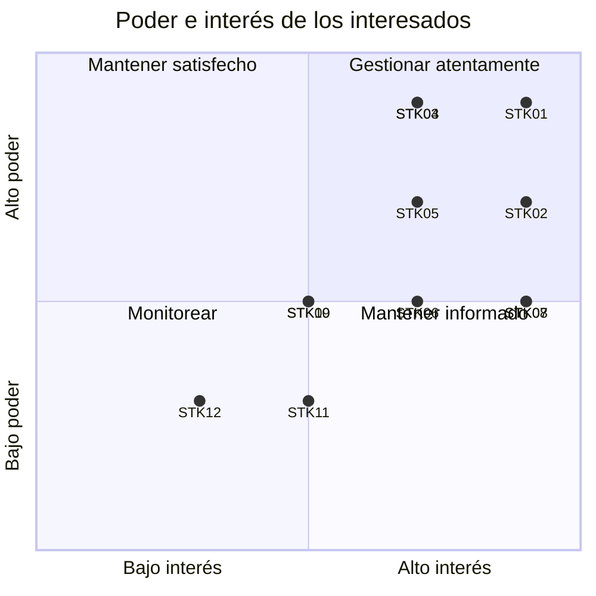

# SISG – Módulo Grupo 4: interesados y comunicaciones

**Versión:** 0.2 (borrador) · **Corte:** 24 de octubre de 2026
> **Declaración de uso de IA:** ver el apéndice en `05_apendice_declaracion_ia.md`.

Los formatos siguen las plantillas del curso: el registro de interesados de la sesión 3 (ID, tipo, expectativa, poder e interés de 1 a 5)
y el plan de comunicaciones y el reporte de estado de la sesión 13. Los actores salen de la tabla de grupos del proyecto integral.
Poder e interés son una **valoración inicial del grupo** y deben validarse.

## 1. Registro de interesados
**TABLA I: REGISTRO DE INTERESADOS**

| ID | Nombre / rol | Tipo | Expectativa principal | Poder (1-5) | Interés (1-5) | Cuadrante |
|---|---|---|---|---:|---:|---|
| STK-01 | Docentes (Ing. Barrios e Inga. Alegre) | Interno | Entregables completos, correctos y a tiempo; declaración de IA y formato IEEE | 5 | 5 | Gestionar atentamente |
| STK-02 | Equipo del Grupo 4 | Interno | Aprobar ambos cursos con la carga repartida | 4 | 5 | Gestionar atentamente |
| STK-03 | Gestor de plataforma (Grupo 8) | Externo | Cumplimiento de seguridad, normas y control de acceso | 5 | 4 | Gestionar atentamente |
| STK-04 | Ministerio de Salud, INE y Estado (Grupo 2) | Externo | Datos confiables y comparables para políticas públicas | 5 | 4 | Gestionar atentamente |
| STK-05 | Hospitales y red pública (Grupos 1 y 2) | Externo | Continuidad de atención con datos de estudios | 4 | 4 | Gestionar atentamente |
| STK-06 | Seguro social (Grupo 3) | Externo | Resultados de diagnóstico de sus afiliados | 3 | 4 | Mantener informado |
| STK-07 | Centros de diagnóstico (usuarios del Grupo 4) | Externo | Registrar estudios rápido y sin errores | 3 | 5 | Mantener informado |
| STK-08 | Organismos no lucrativos (usuarios del Grupo 4) | Externo | Medir personas atendidas y costo por persona en campañas | 3 | 5 | Mantener informado |
| STK-09 | Aseguradoras (Grupo 5) | Externo | Datos agregados para análisis | 3 | 3 | Monitorear |
| STK-10 | Organismos internacionales (Grupo 6) | Externo | Indicadores agregados | 3 | 3 | Monitorear |
| STK-11 | Universidades e investigación (Grupo 7) | Externo | Datos anonimizados para estudios | 2 | 3 | Monitorear |
| STK-12 | Pacientes | Externo | Privacidad de sus datos de salud | 2 | 2 | Monitorear |

Regla de cuadrantes: alto = 4 o 5. Alto poder y alto interés → *Gestionar atentamente*; alto poder y bajo interés → *Mantener satisfecho*;
bajo poder y alto interés → *Mantener informado*; bajo poder y bajo interés → *Monitorear*.

## 2. Matriz poder / interés

**TABLA II: ESTRATEGIA POR INTERESADO**

| Interesado | Expectativa | Cuadrante | Estrategia |
|---|---|---|---|
| Docentes (Ing. Barrios e Inga. Alegre) | Entregables completos, correctos y a tiempo; declaración de IA y formato IEEE | Gestionar atentamente | Reportes de estado y entregas por Classroom; consultar dudas de alcance antes de decidir |
| Equipo del Grupo 4 | Aprobar ambos cursos con la carga repartida | Gestionar atentamente | Reunión semanal de 15 min y registro de horas |
| Gestor de plataforma (Grupo 8) | Cumplimiento de seguridad, normas y control de acceso | Gestionar atentamente | Acordar formatos de datos y requisitos de seguridad; reunión quincenal |
| Ministerio de Salud, INE y Estado (Grupo 2) | Datos confiables y comparables para políticas públicas | Gestionar atentamente | Mostrar el modelo estrella y la reconciliación fuente–DW |
| Hospitales y red pública (Grupos 1 y 2) | Continuidad de atención con datos de estudios | Gestionar atentamente | Entregar esquema y plantillas de carga |
| Seguro social (Grupo 3) | Resultados de diagnóstico de sus afiliados | Mantener informado | Informar avances y el diseño final |
| Centros de diagnóstico (usuarios del Grupo 4) | Registrar estudios rápido y sin errores | Mantener informado | Plantilla CSV, mensajes de error por fila y capacitación breve |
| Organismos no lucrativos (usuarios del Grupo 4) | Medir personas atendidas y costo por persona en campañas | Mantener informado | Informar avances; mostrar el panel y la consulta de campañas |
| Aseguradoras (Grupo 5) | Datos agregados para análisis | Monitorear | Monitorear; compartir solo consultas agregadas |
| Organismos internacionales (Grupo 6) | Indicadores agregados | Monitorear | Monitorear; compartir solo consultas agregadas |
| Universidades e investigación (Grupo 7) | Datos anonimizados para estudios | Monitorear | Monitorear; el DW no contiene datos personales |
| Pacientes | Privacidad de sus datos de salud | Monitorear | Monitorear: no se contactan; se protegen (sin datos personales en el DW) |

## 3. Plan de comunicaciones (plantilla S13)
**TABLA III: PLAN DE COMUNICACIONES**

| Interesado (a quién) | Expectativa (por qué) | Información (qué) | Frecuencia (cuándo) | Medio (cómo) | Responsable (quién) | Formato (plantilla) |
|---|---|---|---|---|---|---|
| Docentes | Entregables correctos y a tiempo | Entregables, reporte de estado, dudas de alcance | Según calendario; reporte cada 2 semanas | Classroom (entrega y comentario privado); correo institucional | Líder | Documento IEEE con apéndice de uso de IA; reporte de estado (plantilla S13) |
| Equipo del Grupo 4 | Carga repartida y bloqueos resueltos | Avance, horas reales, riesgos, decisiones | Semanal (15 min); bloqueos el mismo día | Reunión breve y chat del grupo | Líder | Reporte de estado y registro de horas |
| Gestor de plataforma (Grupo 8) | Seguridad y normas cumplidas | Formato de datos, control de acceso, bitácora | Quincenal | Reunión de coordinación entre grupos | Responsable de datos | Contrato de datos (columnas, tipos, catálogos) |
| Grupos 1, 2 y 3 (fuentes y hospitales) | Cargar datos sin errores | Plantilla CSV y reglas de validación | Una vez y al cambiar el formato | Chat entre grupos y Classroom | Responsable de datos | Plantilla CSV (descargable en la aplicación) |
| Centros y organismos (usuarios) | Registrar rápido y sin errores | Uso de la aplicación, errores de carga por fila | Al entregar y cuando cambie | Aplicación (mensajes en pantalla) y sesión breve | Responsable de aplicación | Guía de una página y plantilla CSV |
| Grupos 5, 6 y 7 (consumidores) | Datos agregados y anónimos | Resultados de consultas analíticas | Al cierre | Documento técnico y consultas del DW | Responsable de datos | Tablas agregadas sin datos personales |
| Ministerio, INE y Estado (Grupo 2) | Indicadores confiables | Modelo estrella y reconciliación fuente–DW | Al cierre | Exposición final | Líder | Presentación y documento técnico |

### Reglas
1. Los datos de pacientes **no** se envían por chat ni correo; solo datos sintéticos o anonimizados.
2. Un problema bloqueante se avisa el mismo día, sin esperar la reunión semanal.
3. Todo documento enviado a los docentes lleva el apéndice de declaración de uso de IA (sanción por omisión: calificación máxima del 60%).

## 4. Reporte de estado (plantilla S13) – corte 24 de octubre de 2026
| Campo | Contenido |
|---|---|
| Proyecto | SISG – Módulo Grupo 4 |
| Período | Hasta el 24 de octubre de 2026 |
| Para | Docentes de Administración de Proyectos y Bases de Datos II |
| Elabora | Equipo del Grupo 4 |
| CPI | *Pendiente: falta registrar el costo real (AC) en horas* |
| SPI | **1.27** (EV 110.1 h / PV 86.6 h) – valor sujeto a validar los % de avance |
| EAC | *Pendiente: requiere CPI* (BAC = 168 h) |
| Avance | **66%** (EV/BAC) |

**Desempeño.** Hecho: ER de las fuentes (entregado), modelo estrella y ETL, aplicación con carga masiva, MFA, roles y auditoría, 49 pruebas e2e en verde,
reconciliación fuente–DW con diferencia 0. Pendiente: presentar el diseño estrella (30 oct.), conectar el ETL con datos reales, documento técnico, informe de cierre y exposición.

**Riesgos principales.** (1) El plazo de Bases de Datos II tiene solo 2 días de holgura y ≈ 74% de probabilidad de cumplirse (riesgo R2).
(2) Fuga de datos de salud de la aplicación (R12): controles aplicados, pendientes HTTPS y cookie HttpOnly antes de publicar. (3) Omitir la declaración de uso de IA limita la nota al 60% (R8).

**Acciones y decisiones.** Decisión tomada: el almacén es MySQL (definitivo; R1 cerrado); cada integrante completa su fila del laboratorio A1-b; registrar horas reales para calcular el CPI; adelantar el ETL con datos reales; usar el apéndice de IA en cada entrega.

Borrador generado con IA: **sí** · Verificado por: ____________________ · Fecha: ____________
