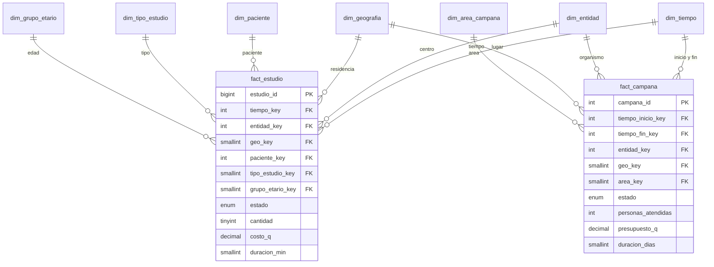
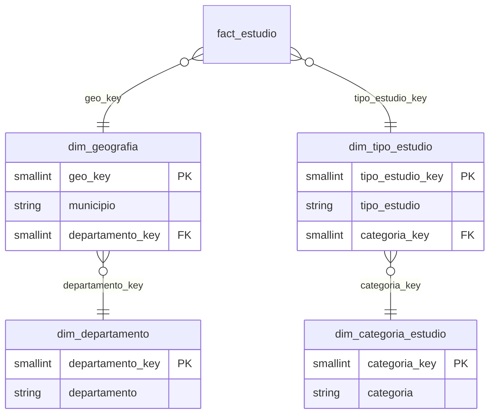

# SISG · Diseño del modelo estrella (Grupo 4)

**Curso:** Bases de Datos II · **Entrega:** diseño estrella/copo de nieve del proyecto final (tarea del 30 de octubre de 2026)
**Versión:** 0.1 (borrador) · Los scripts están en `sql/04_dw_esquema.sql`.

> **Declaración de uso de IA:** ver `../docs/gestion/05_apendice_declaracion_ia.md`.

## 1. Procesos de negocio y preguntas que debe responder
| Proceso | Pregunta de negocio | Hecho |
|---|---|---|
| Estudios diagnósticos (centros) | ¿Cuántos estudios se hicieron e ingresaron por mes, tipo, centro y lugar? | `fact_estudio` |
| Estudios diagnósticos | ¿Qué perfil (sexo, edad) tienen los pacientes por tipo de estudio? | `fact_estudio` |
| Campañas de salud (organismos) | ¿Cuántas personas atendió cada área y a qué costo por persona? | `fact_campana` |
| Ambos | ¿Dónde hay más estudios y dónde más campañas, por departamento? | los dos, por dimensión conformada |

## 2. Granos y medidas
| Hecho | Grano (una fila es…) | Medida | Aditividad |
|---|---|---|---|
| `fact_estudio` | un estudio diagnóstico | `cantidad` (=1) | aditiva |
| | | `costo_q` | aditiva |
| | | `duracion_min` | aditiva en suma, pero se analiza como **promedio** |
| `fact_campana` | una campaña de salud | `personas_atendidas` | aditiva |
| | | `presupuesto_q` | aditiva |
| | | `duracion_dias` | se analiza como **promedio** (sumarla entre campañas no tiene sentido) |

Atributos degenerados (sin dimensión propia): `estudio_id`, `campana_id` y `estado` en cada hecho.
Las consultas de ingresos filtran `estado = 'REALIZADO'`.

## 3. Matriz de dimensiones conformadas (bus matrix)
| Dimensión | `fact_estudio` | `fact_campana` | Conformada |
|---|:-:|:-:|:-:|
| `dim_tiempo` | ✔ | ✔ (inicio y fin) | **sí** |
| `dim_geografia` | ✔ (residencia del paciente) | ✔ (lugar de la campaña) | **sí** |
| `dim_entidad` | ✔ (centro) | ✔ (organismo) | **sí** |
| `dim_paciente` | ✔ | – | no |
| `dim_grupo_etario` | ✔ | – | no |
| `dim_tipo_estudio` | ✔ | – | no |
| `dim_area_campana` | – | ✔ | no |

Las tres dimensiones conformadas tienen la misma estructura y claves en los dos hechos; por eso se pueden
cruzar estudios y campañas por departamento (consulta 6 de `06_consultas.sql`) sin inventar uniones.

## 4. Diccionario de dimensiones
| Dimensión | Llave | Atributos | Jerarquía | Notas |
|---|---|---|---|---|
| `dim_tiempo` | `tiempo_key` (yyyymmdd) | fecha, año, trimestre, mes, nombre del mes, día, día de la semana, fin de semana | día → mes → trimestre → año | Se genera con un procedimiento; rango 2024–2027 |
| `dim_geografia` | `geo_key` | departamento, municipio | municipio → departamento | Fila `-1` = desconocido; una fila por departamento (sin municipio) |
| `dim_entidad` | `entidad_key` | nombre, tipo de entidad, departamento | – | Distingue centros de organismos |
| `dim_paciente` | `paciente_key` | sexo | – | **Sin nombre ni DPI**: datos de salud |
| `dim_grupo_etario` | `grupo_etario_key` | etiqueta (0-14, 15-29, 30-44, 45-59, 60+) | – | La edad se calcula **al día del estudio** |
| `dim_tipo_estudio` | `tipo_estudio_key` | tipo, categoría | tipo → categoría | |
| `dim_area_campana` | `area_key` | área | – | |

## 5. Diagrama

## 6. ¿Estrella o copo de nieve?
**Decisión: estrella.** Criterios de la clase 12 aplicados a SISG:

| Criterio | Aplicación a SISG | Resultado |
|---|---|---|
| Velocidad | Las consultas analíticas hacen 2 a 3 uniones en estrella; en copo de nieve serían 4 a 5 | Estrella |
| Usuarios de negocio | Ministerio, aseguradoras y universidades consultan indicadores; no deben entender jerarquías | Estrella |
| Jerarquías de 1–2 niveles | Geografía (municipio → departamento) y estudio (tipo → categoría) tienen **2 niveles** | Estrella |
| Ahorro de espacio | `dim_geografia` ≈ 55 filas y `dim_tipo_estudio` ≈ 10: normalizarlas no ahorra nada | Estrella |
| Integridad estricta | Se resuelve **en la fuente** con catálogos y llaves foráneas, no en el DW | Estrella |
| Dimensión que cambia mucho | Las dimensiones casi no cambian | Estrella |

**Evidencia del problema de integridad:** al cargar datos de la app, el departamento llegaba escrito de formas distintas
(por ejemplo `sacatepequez` y `Sacatepéquez`). Eso se corrige al limpiar contra el catálogo del esquema fuente
(`puente/02_mapeo.sql`); el DW recibe un solo nombre por departamento, así que no necesita normalizarlo otra vez.

### Variante en copo de nieve (si se pidiera)
Solo conviene normalizar la dimensión que da problemas (modelo mixto). La candidata es `dim_geografia`:

**Costo:** "estudios por departamento" pasaría de 1 a 2 uniones sobre geografía, y "estudios por categoría" de 1 a 2 sobre tipo.
**Beneficio:** cambiar el nombre de un departamento o de una categoría se hace en 1 fila. Con tan pocas filas no compensa.

## 7. Tabla de sumarización
`fact_estudio_mensual` guarda estudios realizados, ingresos y duración promedio por **mes, centro y tipo de estudio**
(≈ 1,800 filas frente a ≈ 12,000 del hecho). Se pierde la geografía a propósito: con ella la tabla casi no se reducía
(10,106 filas contra 12,219 en la primera prueba). Las consultas 1 y 8 responden la misma pregunta; compárense con `EXPLAIN`.

## 8. Decisiones de diseño y límites
- **Cambios en las dimensiones (SCD):** se usa tipo 1 (sobrescribir); el ETL recarga todo, así que no se conserva historia de
  cambios en nombres o clasificaciones. Para historia habría que pasar a tipo 2 (fila nueva con vigencia).
- **Dimensión de tiempo en dos roles** en `fact_campana` (inicio y fin), sin duplicar la tabla.
- **Valores desconocidos** (`-1`) para no perder hechos cuando falta un lugar o una fecha de nacimiento.
- **Costo y duración** son medidas reales en los datos sintéticos; con datos de la app son **valores de lista del catálogo**
  porque la aplicación aún no los registra (ver `README.md`).
- **Privacidad:** el DW no contiene nombre, DPI, teléfono ni contacto; solo sexo y grupo de edad.
