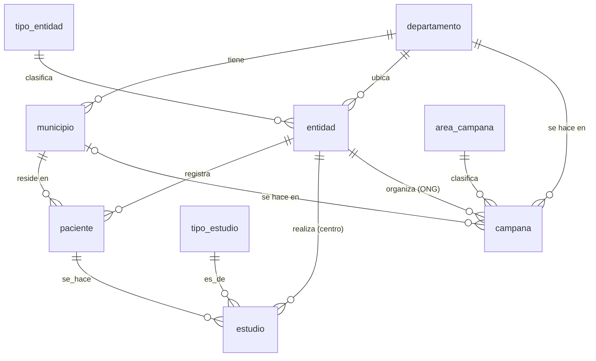
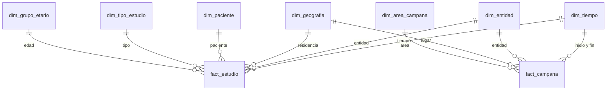

# SISG · Almacén de datos del Grupo 4 (MySQL)

Proyecto final de Bases de Datos II: ER de las fuentes, modelo estrella, ETL y consultas.
Todo corre en un MySQL 8 de Docker, separado del app de Postgres. Los datos son sintéticos.

## Cómo correrlo

```bash
cd dw
./run.sh          # levanta MySQL (puerto 3307), crea fuente + DW, genera datos y corre el ETL
./consultas.sh    # ejecuta sql/06_consultas.sql y muestra los resultados
docker compose down -v   # borra todo
```

Usuario `root`, contraseña `sisg_dev` (solo local).

| Archivo | Entregable |
|---|---|
| `sql/01_fuente_esquema.sql` | **ER de las fuentes**: tablas, llaves, restricciones, índices |
| `sql/02_fuente_datos.sql` | Datos sintéticos (≈6,000 pacientes, ≈12,000 estudios, 150 campañas) |
| `sql/03_fuente_triggers.sql` | Reglas de negocio y bitácora de auditoría |
| `sql/04_dw_esquema.sql` | **Modelo estrella**, tabla de sumarización, rol `analista` |
| `sql/05_dw_etl.sql` | **ETL** con procedimientos almacenados y `etl_log` |
| `sql/06_consultas.sql` | **Queries** analíticos |

## Alimentar el DW desde la app (Postgres → MySQL)

```bash
./run_app.sh            # lee la base `sisg` del app (contenedor backend-db-1)
./run_app.sh sisg_demo  # base de demostración con datos "sucios" a propósito
```

Pasos: la app exporta sus tablas a CSV (sin contraseñas) → `sisg_stg` (staging, sin validar) → mapeo a los catálogos de
`sisg_fuente` (`puente/02_mapeo.sql`) → triggers → DW → ETL → reconciliación. Reglas del mapeo:

| Dato de la app | Qué se hace |
|---|---|
| Departamento y municipio en texto | Se enlazan al catálogo sin distinguir mayúsculas ni tildes; si no existe, queda vacío y se cuenta en el resumen |
| Tipo de estudio escrito libremente | Si no está en el catálogo se agrega como "Sin clasificar" |
| Estado libre del estudio | `realiz…` → REALIZADO, `cancel…` → CANCELADO, lo demás → PROGRAMADO |
| Fecha de fin anterior al inicio de una campaña | Se descarta (la app no lo valida) |
| **Costo y duración del estudio** | **La app no los registra**: se usa el precio y la duración *de lista* del catálogo. No son montos reales cobrados |
| Presupuesto de campaña | La app no lo registra: queda vacío |

Los ids de la app se conservan para poder rastrear cada fila. Solo se admiten fechas entre 2024 y 2027 (rango de `dim_tiempo`).

## ER de las fuentes



Cambios frente al modelo del app: catálogos en lugar de texto libre, DPI único por entidad, `costo_q`, `duracion_min` y
`presupuesto_q` como medidas, y una `bitacora`. Estas columnas nuevas no existen todavía en el app.

## Modelo estrella



- **Grano `fact_estudio`:** un estudio. Medidas: `cantidad`, `costo_q`, `duracion_min`.
- **Grano `fact_campana`:** una campaña. Medidas: `personas_atendidas`, `presupuesto_q`, `duracion_dias`.
- **Dimensiones conformadas:** `dim_tiempo`, `dim_geografia` y `dim_entidad` las comparten los dos hechos, así que se pueden cruzar (consulta 6).
- **`dim_tiempo` con dos roles** en `fact_campana` (inicio y fin).
- **Sin datos personales:** el DW guarda sexo y grupo de edad, no nombre ni DPI. El grupo de edad se calcula a la fecha del estudio.
- **`fact_estudio_mensual`:** tabla de sumarización (≈1,800 filas contra ≈12,000). Compara las consultas 1 y 8 con `EXPLAIN`.

### Estrella o copo de nieve
Se quedó en estrella pura por la regla de la clase 12 ("empieza siempre en estrella"). El candidato a copo de nieve
es `dim_geografia` (departamento → municipio): solo conviene si la jerarquía crece o hay que garantizar nombres únicos.

## Decisiones y límites (para la sustentación)

- **ETL de recarga completa.** Borra y vuelve a cargar. Con este volumen basta. Para producción: carga incremental con marca de agua en `etl_log`.
- **Dato desconocido:** `geo_key = -1` y `grupo_etario_key = -1` evitan perder hechos sin municipio o sin fecha de nacimiento.
- **Datos sintéticos aleatorios:** los resultados de las consultas no significan nada real.
- **La app sigue en Postgres.** Este DW no se alimenta del app, sino del esquema `sisg_fuente`. Falta decidir cómo conectarlos.

## Si la profesora pide SQL Server (T-SQL)

| MySQL (aquí) | SQL Server |
|---|---|
| `AUTO_INCREMENT` | `IDENTITY(1,1)` |
| `ENUM(...)` | `VARCHAR` + `CHECK (... IN (...))` |
| `DELIMITER $$ ... END$$` | `CREATE PROCEDURE ... AS BEGIN ... END` |
| `ELT(n, ...)` | `CHOOSE(n, ...)` |
| `CURDATE()` / `NOW()` | `CAST(GETDATE() AS DATE)` / `GETDATE()` |
| `DATE_ADD(f, INTERVAL n DAY)` | `DATEADD(DAY, n, f)` |
| `TIMESTAMPDIFF(YEAR, a, b)` | `DATEDIFF(YEAR, a, b)` (cuenta años de calendario, no cumplidos) |
| `SIGNAL SQLSTATE '45000'` | `THROW 50000, 'mensaje', 1` |
| `WITH RECURSIVE` | `WITH` (sin `RECURSIVE`) |
| `RAND()` por fila | `ABS(CHECKSUM(NEWID()))` (en T-SQL `RAND()` da el mismo valor a toda la consulta) |
| Triggers `FOR EACH ROW` | Triggers por sentencia con tablas `inserted` / `deleted` |
| `CREATE ROLE` + `GRANT` | igual |
| Funciones de ventana, `LAG`, `RANK` | igual |
